<div align="center">

# 🛡️ FirstRecord

**Multilingual case & statement management for police stations — with a Hindi/English voice assistant that drives the app.**

[](https://firstrecord.onrender.com)


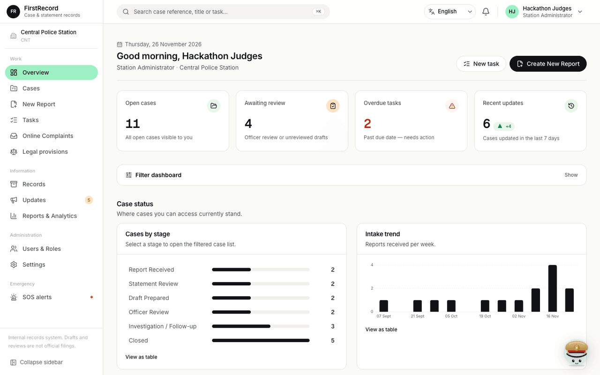

</div>

> [!IMPORTANT]
> **Hackathon review login** (intentionally public, fictional data only)
> **Demo ID:** `judges@firstrecord.example` · **Password:** `FirstRecord@2026`
> The sign-in page also has a **Use demo login** button. The free hosting tier sleeps when idle: the first visit can take **~1 minute** to wake up, and the demo data resets on restart.

---

## 📑 Contents

- [Try it in 60 seconds](#-try-it-in-60-seconds)
- [Why FirstRecord](#-why-firstrecord)
- [Features](#-features)
- [Meet साथी — the voice mascot](#-meet-साथी--the-voice-mascot)
- [Architecture](#-architecture)
- [Tech stack](#-tech-stack)
- [Security & responsible AI](#-security--responsible-ai)
- [Testing & analysis](#-testing--analysis)
- [Run it locally](#-run-it-locally)
- [Deploy](#-deploy)
- [Project structure](#-project-structure)
- [Roadmap](#-roadmap)
- [Team](#-team)

---

## ⚡ Try it in 60 seconds

| Step | What to do | What you'll see |
|---|---|---|
| 1 | Open **[firstrecord.onrender.com](https://firstrecord.onrender.com)** and click **Use demo login → Sign in** | The station dashboard |
| 2 | Wait a second | The police-cap mascot lifts from the corner to the centre with **Talk to me** |
| 3 | Click **Talk to me** and allow the microphone | साथी greets you in Hindi |
| 4 | Say **"cases पर जाओ"** or **"go to SOS"** | The mascot flies to the sidebar link, opens the page and stays there |
| 5 | Say **"नई FIR दर्ज करनी है"** | It asks name → phone → incident → date → place and types each answer into the form |
| 6 | Say **"bye"** / **"हो गया"** | The call ends and the mascot returns to its corner |

<p align="center">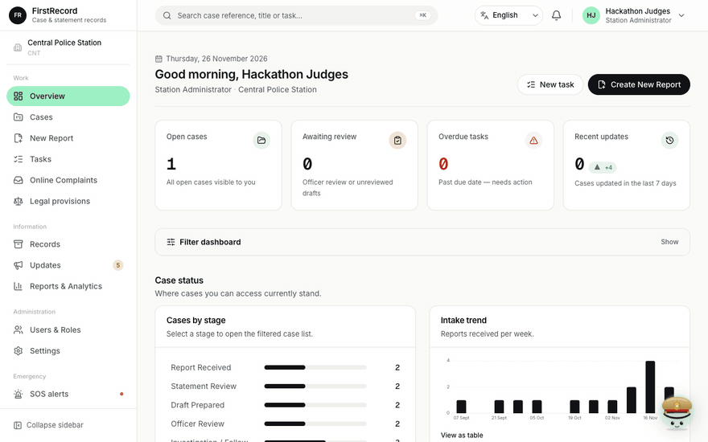</p>

> [!TIP]
> No microphone? Press <kbd>⌘</kbd>/<kbd>Ctrl</kbd> + <kbd>K</kbd> for the command palette — search cases, jump to any page or start a quick action.

---

## 🎯 Why FirstRecord

At many police stations a complaint still travels through **handwritten notes, re-typed registers and memory**:

- statements are paraphrased in a language the complainant may not read back,
- two people's details can get mixed up when records are copied by hand,
- legal sections are picked from memory after the move from IPC to BNS (July 2024),
- citizens get no status after they leave the station.

FirstRecord keeps **the statement accurate and traceable from the first report onwards** — and keeps officers in control of every decision.

---

## ✨ Features

<table>
<tr>
<td width="50%"><br><b>Interactive dashboard</b> — clickable KPI cards with count-up numbers, cases by stage (click a bar to filter), weekly intake trend, live activity with auto-refresh.</td>
<td width="50%">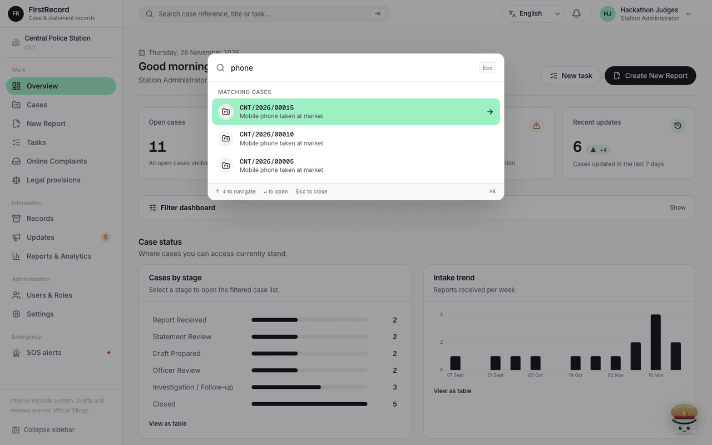<br><b>⌘K command palette</b> — fuzzy search over pages, quick actions and the cases you're allowed to see (RBAC-scoped).</td>
</tr>
<tr>
<td>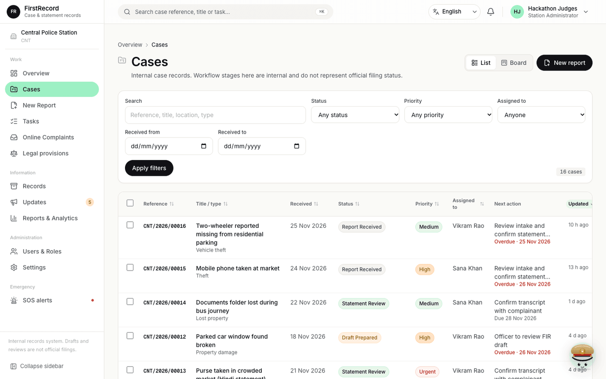<br><b>Cases</b> — list & board views, filters, sortable columns, clickable rows, a 6-stage case workflow.</td>
<td>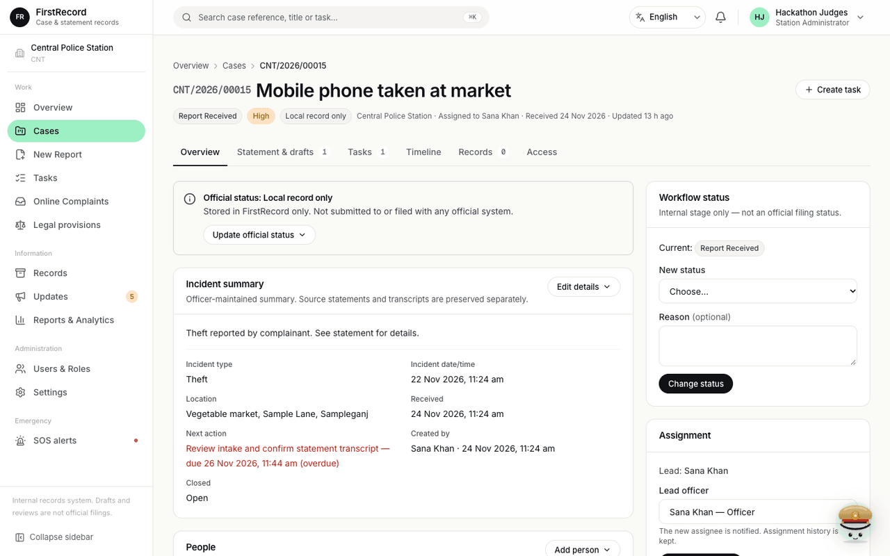<br><b>Case detail</b> — summary, workflow status, people, statements, drafts, tasks, timeline and access history.</td>
</tr>
<tr>
<td>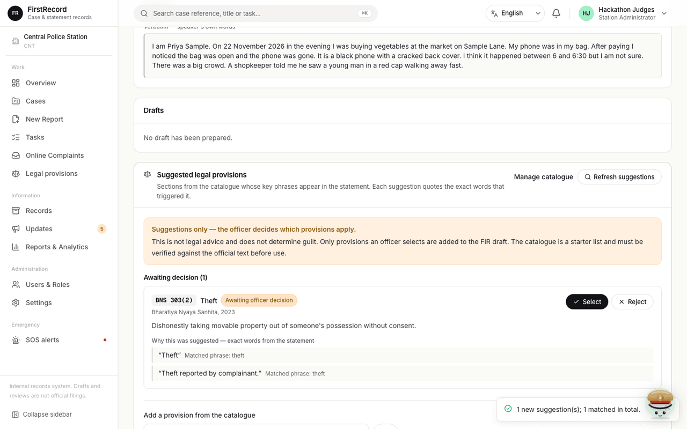<br><b>Legal section suggestions</b> — BNS 2023 / IT Act sections suggested from a 43-entry catalogue, each with the <i>exact sentence</i> that triggered it. The officer selects; only selected sections reach the FIR draft.</td>
<td>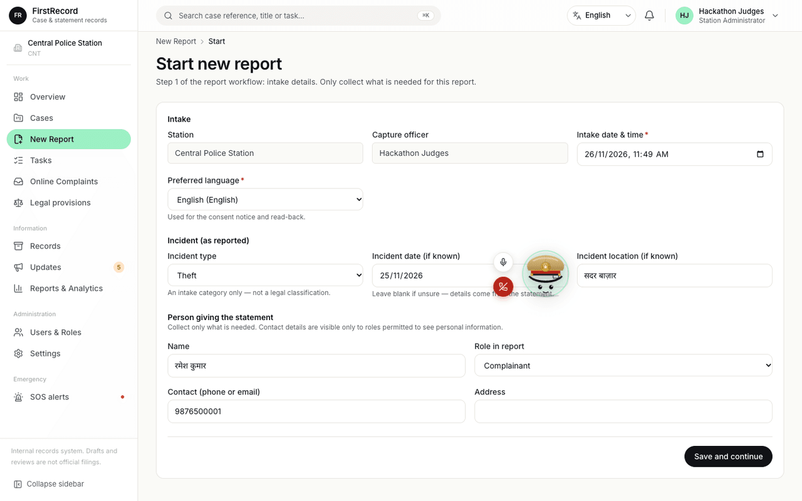<br><b>New report (FIR intake)</b> — consent before any recording, typed/assisted/audio capture, on-device transcription, read-back, and human-reviewed AI drafts.</td>
</tr>
<tr>
<td>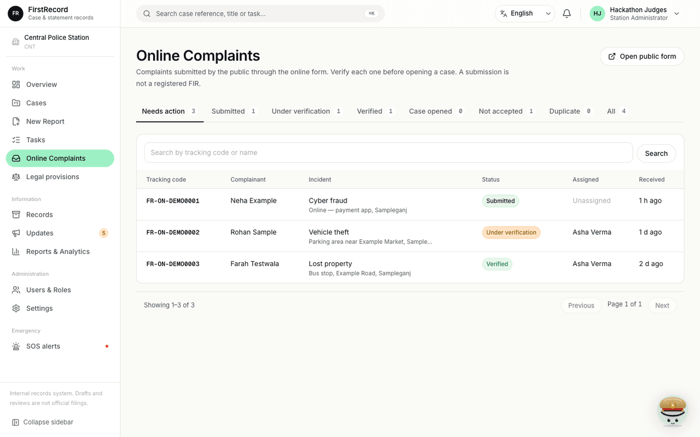<br><b>Online complaints</b> — a staff queue to verify public submissions and convert them into cases in one click.</td>
<td>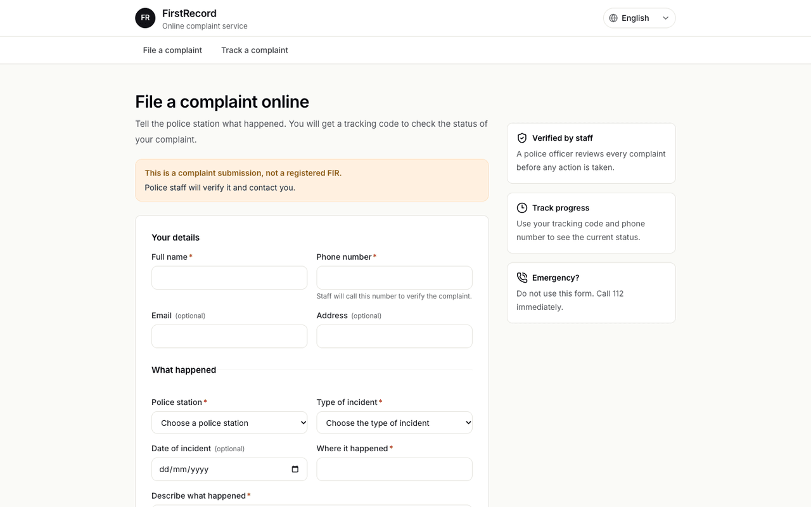<br><b>Public complaint form</b> — no sign-in, tracking code, clearly marked as <i>not</i> a registered FIR.</td>
</tr>
<tr>
<td>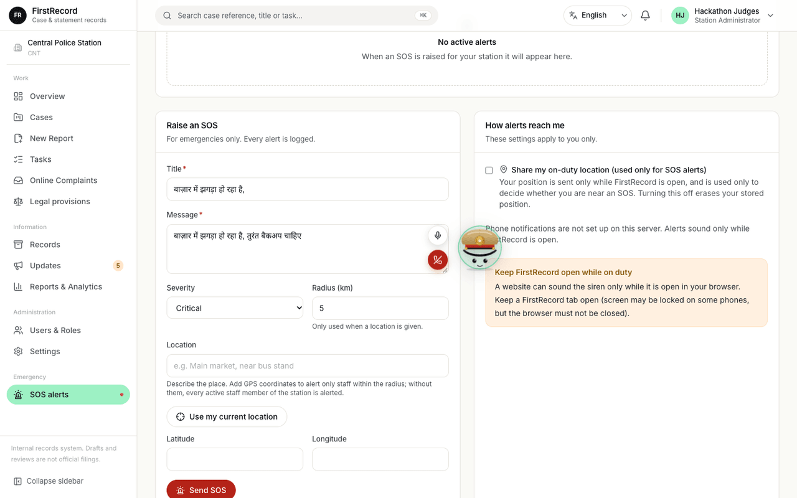<br><b>Geo-targeted SOS</b> — full-screen siren on nearby on-duty staff devices, one-tap responses, Web Push.</td>
<td>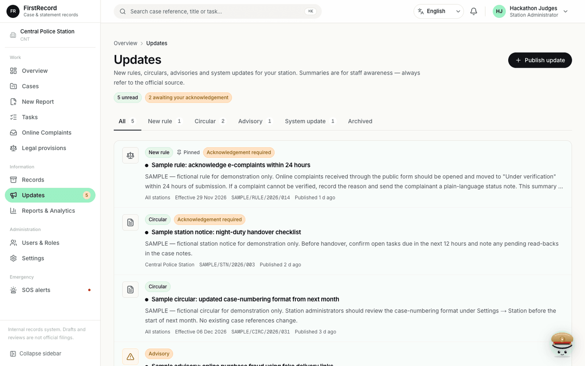<br><b>Updates & new rules</b> — circulars and rule changes for every account, with read and acknowledgement tracking.</td>
</tr>
<tr>
<td>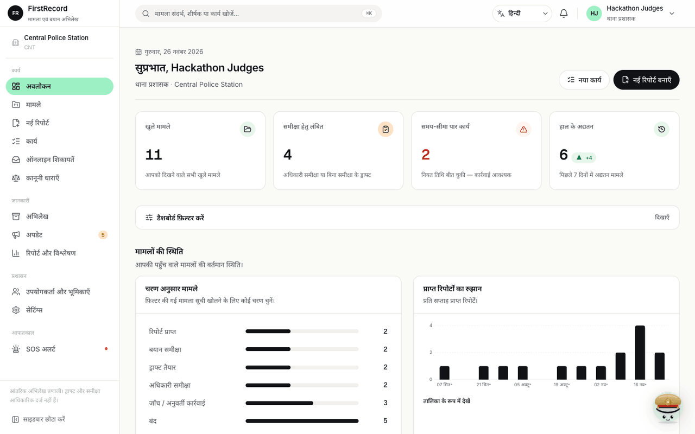<br><b>10 Indian languages</b> — English, हिन्दी, বাংলা, मराठी, తెలుగు, தமிழ், ગુજરાતી, ಕನ್ನಡ, മലയാളം, ਪੰਜਾਬੀ.</td>
<td>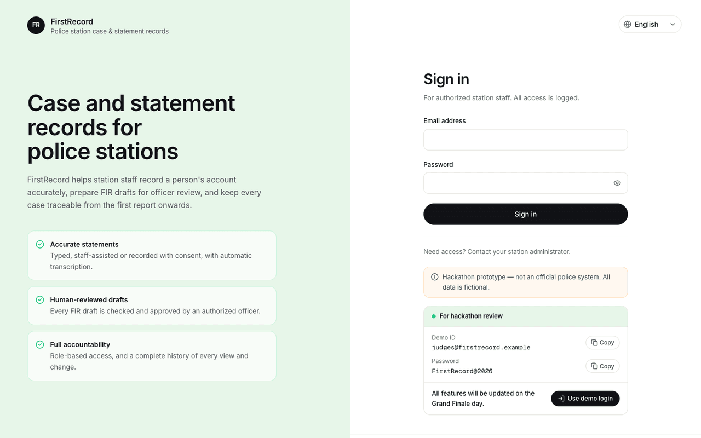<br><b>Sign-in</b> — review panel with copy buttons and <i>Use demo login</i>, show/hide password.</td>
</tr>
</table>

---

## 🧢 Meet साथी — the voice mascot

An original police-cap character that lives in the bottom-right corner. Talk to it in **Hindi, English or Hinglish** and it **operates the website for you**: it opens pages, fills the FIR and SOS forms field by field, and opens cases by number.

<table>
<tr>
<td width="50%">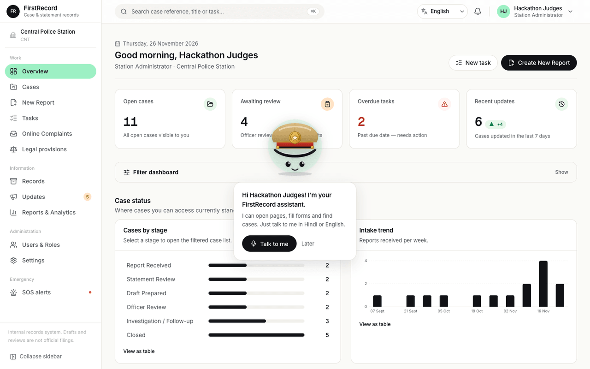<br>After sign-in the cap glides to the centre and offers <b>Talk to me</b>.</td>
<td width="50%">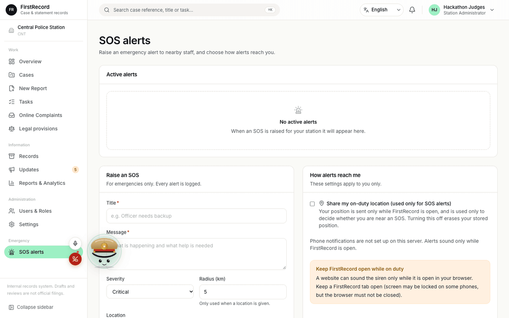<br>During a call there is no chat window — only the mascot, a mute button and a red end-call button.</td>
</tr>
</table>

### How it talks — the pipeline

No LLM tool calling on the voice path, so replies are fast: speech is transcribed, a deterministic Hindi/English intent engine decides what to do, and the UI acts **while** the reply is spoken.

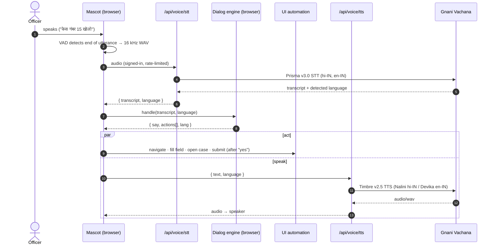

> [!NOTE]
> The Gnani API key lives **only on the server** (`GNANI_API_KEY`). The browser talks to FirstRecord's own `/api/voice/*` routes, which require a signed-in user and are rate-limited.

### How it moves

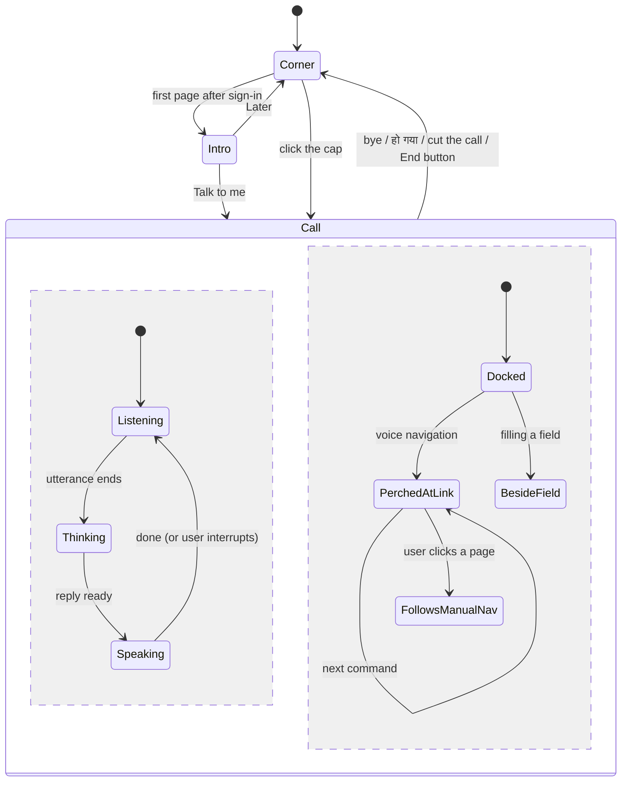

### What you can say

| You say | Language | What happens |
|---|---|---|
| "cases पर जाओ" · "डैशबोर्ड खोलो" | Hindi | Flies to the sidebar link and opens the page |
| "go to SOS" · "open updates" | English | Same, replies in English |
| "केस नंबर पंद्रह खोलो" · "open case 15" | Hindi / English | Finds `CNT/2026/00015` and opens it |
| "नई FIR दर्ज करनी है" · "file an FIR" | Hindi / English | Step-by-step intake: name → phone → incident type → date ("आज", "कल", "15 नवंबर") → place → what happened; each answer is typed into **exactly** the matching field; asks "आगे बढ़ा दूँ?" before submitting |
| "records पे जाओ" (in the middle of an FIR) | Hindi / English | **Navigation always wins** — opens Records; the FIR is paused, never typed into |
| "FIR जारी रखो" · "नई रिपोर्ट पे जाओ" · "continue the FIR" | Hindi / English | Resumes the paused FIR and refills what was already collected |
| "नहीं, नाम गलत है" · "फोन बदलो" · "change the location" | Hindi / English | Re-asks **only that field** and replaces its value; nothing else is cleared |
| "नाम रमेश कुमार है" · "फोन नंबर 98765 43210 है" · "my name is Ramesh" | Hindi / English | Fills that field directly, then continues with the next missing one |
| "पिछला बदलो" · "go back" | Hindi / English | Re-asks the previous answer only |
| "हाँ" / "आगे बढ़ो" / "next" (after the statement is saved) | Hindi / English | Walks the intake wizard: transcript review (offers read-back) → FIR **draft** → review → create case → complete |
| "SOS भेजना है" · "send an SOS" | Hindi / English | Asks what to write, fills title & message, asks for location, **sends only after an explicit "हाँ" / "yes"**; "मत भेजो" cancels |
| "English में बोलो" · "speak in English" · "हिंदी में बात करो" | any | Switches the reply language immediately |
| "bye" · "cut the call" · "हो गया" · "धन्यवाद" | any | Ends the call, mascot goes home |

> [!IMPORTANT]
> **Consequential steps need a clear "हाँ" / "yes"** — submitting an SOS, sending the report forward, opening review and creating the case ("ठीक है" alone is not enough). **Recording consent is never given by voice** — the officer confirms it on screen. AI output is always a draft for an authorised officer.

**Reply language rule:** the reply language follows the language Gnani detects for each utterance (`hi-IN` → Hindi, `en-IN` → English). Hindi spoken with English words ("cases पर जाओ", "मेरा phone चोरी हो गया") stays Hindi. It switches only after **two clear utterances** in the other language, or immediately when you ask — short replies like "हाँ", "yes", numbers or names never flip it.

**Where the mascot sits during a call:** it stays where its last action took it — perched beside the sidebar link it navigated to, or next to the field it just filled. If you navigate manually it follows to that page's link. It does not follow the mouse cursor. It returns to the bottom-right corner **only** when the call ends. The green ring around the cap grows with your voice level so you can see it hears you, and after ~12 s of silence it shows a "speak a little louder" hint.

<details>
<summary><b>Incident-type mapping (spoken → form value)</b></summary>

| Spoken (examples) | Form value |
|---|---|
| साइबर, online, UPI, OTP, लिंक, बैंक | Cyber fraud |
| वाहन, गाड़ी, बाइक, स्कूटर, कार | Vehicle theft |
| सेंधमारी, घर में चोरी, ताला तोड़ | Burglary |
| धोखा, धोखाधड़ी, fraud, ठगी | Cheating / Fraud |
| गुमशुदा, लापता | Missing person |
| गुम, खो गया, lost, missing | Lost property |
| चोरी, छीना, snatch, मोबाइल, पर्स | Theft |
| मारपीट, हमला | Assault |
| छेड़छाड़, उत्पीड़न, पीछा | Harassment |
| तोड़फोड़, नुकसान, आग | Property damage |
| anything else | Other |

</details>

---

## 🏗️ Architecture

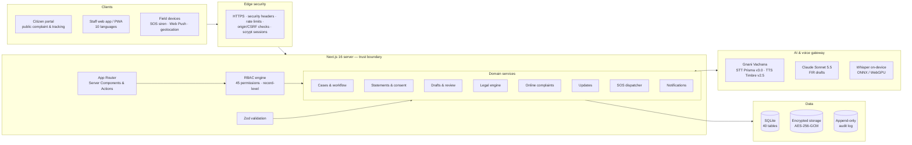

<details>
<summary><b>Data model highlights</b></summary>

- **40 tables** across 2 versioned migrations (`src/lib/db/migrations.ts`), run automatically on start.
- Cases, statements, transcript versions, recordings, consent events (append-only), drafts with field-level versions, reviews, tasks, notifications.
- Legal provisions catalogue + per-statement suggestions with verbatim evidence.
- Online complaints, bulletins + read/acknowledge, SOS alerts + recipients, user locations (opt-in), push subscriptions.
- Audit events for every view and change.

</details>

---

## 🧰 Tech stack

| Layer | Technologies |
|---|---|
| Frontend | Next.js 16 (App Router), React 19, TypeScript 6, Tailwind CSS 4, Inter + Geist Mono, Lucide icons |
| Backend | Node.js 24, Server Actions, Zod 4, Web Push (VAPID) |
| Data | SQLite via `node:sqlite`, versioned migrations, AES-256-GCM file storage, scrypt password hashing |
| Voice | Gnani Vachana — Prisma v3.0 (STT), Timbre v2.5 (TTS: Nalini hi-IN, Devika en-IN); Web Audio API (VAD, playback) |
| AI | Claude Sonnet 5.5 via Anthropic SDK (FIR drafts), OpenAI Whisper base/small in the browser (Transformers.js + ONNX Runtime Web) |
| Realtime & geo | Geolocation API, Haversine targeting, Web Audio siren, Vibration API |
| Quality | Vitest (240 tests in 16 suites), ESLint, strict TypeScript |
| Ops | Docker (multi-stage), Render blueprint, health check `/api/health` |

---

## 🔐 Security & responsible AI

- **AI assists, people decide** — AI never files an FIR, approves a draft or decides guilt. Drafts are labelled and human-reviewed.
- **Consent first** — no recording starts without the speaker's recorded consent.
- **Evidence, not scores** — legal suggestions show the exact source sentence; there is no risk or credibility scoring.
- **Role-based access** — 45 permissions with record-level checks; 5 built-in roles.
- **Accountability** — append-only audit trail of every view and change.
- **Protected data** — recordings and attachments encrypted with AES-256-GCM; passwords hashed with scrypt.
- **Voice safety** — SOS and FIR submission need an explicit "yes"; the Gnani key never reaches the browser.
- **Honest framing** — a hackathon prototype with fictional data; not an official police system.

---

## 🧪 Testing & analysis

```
 Test Files  16 passed (16)
      Tests  240 passed (240)
```

<details>
<summary><b>Automated test suites (Vitest)</b></summary>

| Suite | Tests | Covers |
|---|---:|---|
| `voice-dialog` | 118 | Hindi/English intents, case-number parsing (digits + Hindi words), FIR & SOS flows, navigation mid-flow, field corrections, direct value statements, pause/resume, intake wizard steps, confirmations, language detection & switching, end phrases |
| `rbac` | 15 | Role grants, read-only roles, record-level access |
| `legal` | 12 | Catalogue matcher, quoted evidence, Hindi statements |
| `workflow-e2e` | 12 | Intake → statement → draft → review end to end |
| `workflow` | 9 | Case state machine and transitions |
| `sos` | 9 | Haversine distance and recipient targeting |
| `ai-demo` | 8 | Demo FIR draft generation |
| `online` | 8 | Complaint validation, tracking lookup, case conversion |
| `updates` | 8 | Bulletin audience, publishing, acknowledgements |
| `seed` | 7 | Idempotent demo seeding |
| `storage` | 7 | Encrypted file storage |
| `db` | 6 | Migrations and helpers |
| `audit-summary` | 5 | Translated audit summaries |
| `timestamps` | 5 | Date handling |
| `password` | 4 | scrypt hashing and policy |
| `audit` | 3 | Append-only audit log |

</details>

<details>
<summary><b>Manual & browser testing</b></summary>

- **Headless Chrome flows** (puppeteer-core): sign-in via *Use demo login*, every main page, ⌘K palette search, mascot intro, voice/text pipeline (navigate, open case, FIR fill, SOS fill + cancel), mascot positioning (perched at link, follows manual navigation, returns home on end).
- **Live Gnani checks**: TTS → STT round trips in Hindi and English; language detection (`hi-IN` / `en-IN`).
- **Deploy smoke tests**: `/api/health`, sign-in and page loads on Render after every push; Docker image built and run locally.
- **Accessibility**: keyboard navigation, focus management, `aria-live` status for the voice assistant, reduced-motion support.

</details>

> [!WARNING]
> **Known limitations**
> - Free hosting sleeps when idle; the first request takes ~1 minute and demo data resets on restart.
> - Voice needs a microphone and HTTPS (or localhost); browsers block audio until you interact with the page.
> - Gnani latency varies — usually about 1 s, occasionally much longer.
> - The hosted demo generates FIR drafts in demo mode unless an Anthropic API key is configured.
> - If the page is reloaded during a call, the call is restored from the session; browsers may need one tap on the cap to re-enable the microphone and sound.

---

## 💻 Run it locally

```bash
git clone https://github.com/lalamansingh/FirstRecord.git
cd FirstRecord
npm install
cp .env.example .env.local
```

Set these in `.env.local`:

```bash
SESSION_SECRET=<random base64>          # node -e "console.log(require('crypto').randomBytes(32).toString('base64'))"
STORAGE_ENCRYPTION_KEY=<32-byte base64>
DEMO_MODE=true
GNANI_API_KEY=<your Gnani Vachana key>  # server-side only; needed for the voice mascot
JUDGE_EMAIL=judges@firstrecord.example  # optional: evaluation account
JUDGE_PASSWORD=<12+ chars>
```

```bash
npm run db:seed   # schema + fictional demo data
npm run dev       # http://localhost:3000
```

<details>
<summary><b>All scripts</b></summary>

| Command | What it does |
|---|---|
| `npm run dev` | Development server |
| `npm run build` / `npm start` | Production build / server |
| `npm run db:seed` | Create schema and seed demo data (if empty) |
| `npm run db:reset` | Wipe and reseed (demo mode only) |
| `npm run user:create` | Create a user from the CLI |
| `npm test` | Run the Vitest suite |
| `npm run check` | Typecheck + lint + test + build |

</details>

---

## 🚀 Deploy

[](https://render.com/deploy?repo=https://github.com/lalamansingh/FirstRecord)

- **Render** — the blueprint (`render.yaml`) runs the Docker image on the free plan. Set `JUDGE_PASSWORD`, `SEED_PASSWORD` and `GNANI_API_KEY` in the dashboard.
- **Docker** — `docker build -t firstrecord . && docker run -p 3000:3000 --env-file .env.local -v firstrecord-data:/data firstrecord`
- Full guide: [`docs/DEPLOYMENT.md`](docs/DEPLOYMENT.md)

---

## 🗂️ Project structure

```
FirstRecord/
├── src/
│   ├── app/                 # Next.js routes: (app) staff pages, /complaint public pages, /api routes
│   │   └── api/voice/       # stt + tts proxies to Gnani (key stays server-side)
│   ├── components/
│   │   ├── voice/           # mascot, mascot art, dialog engine, audio engine, UI automation
│   │   ├── interactive/     # KPI cards, count-up, clickable rows, live refresh
│   │   ├── command-palette.tsx
│   │   └── …                # cases, intake, drafts, legal, online, sos, updates, admin, ui
│   └── lib/
│       ├── db/              # node:sqlite, migrations, auto-seed
│       ├── domain/          # cases, statements, drafts, legal, online, bulletins, sos, …
│       ├── rbac/            # 45 permissions, roles, access checks
│       ├── i18n/            # 10 UI languages
│       └── voice/           # Gnani client (server-only)
├── tests/                   # 16 Vitest suites
├── docs/                    # architecture, security, API, deployment, screenshots
├── scripts/                 # seed, migrate, create-user, docker entrypoint
├── Dockerfile · render.yaml · railway.json
└── README.md
```

---

## 🛣️ Roadmap

- [x] Multilingual statement capture, read-back and consent
- [x] Human-reviewed AI FIR drafts and BNS/IT Act suggestions with evidence
- [x] Online complaints, updates feed, geo-targeted SOS
- [x] Voice mascot in Hindi & English (Gnani Vachana)
- [ ] Retrieval over the legal catalogue and circulars with citations
- [ ] Station pilot, then district rollout
- [ ] CCTNS / e-court data exchange and state SSO

---

## 👥 Team

| Name | Course | Institution |
|---|---|---|
| **Lal Aman Singh** | CSE, 3rd year | Lloyd Institute of Management and Technology |
| **Ayushi Tiwari** | B.Tech CSE, 2nd year | Lloyd Institute of Engineering & Technology (AKTU) |

<div align="center">

<sub>Built for <b>Innovate UP 2026</b>. FirstRecord is a prototype with fictional data — not an official police system and not affiliated with any government department.</sub>

</div>
